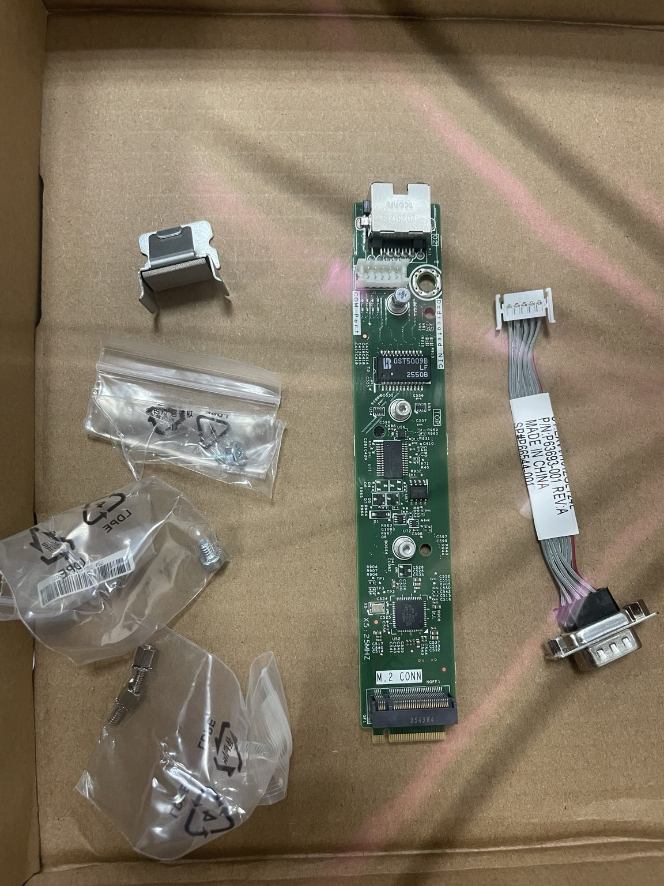
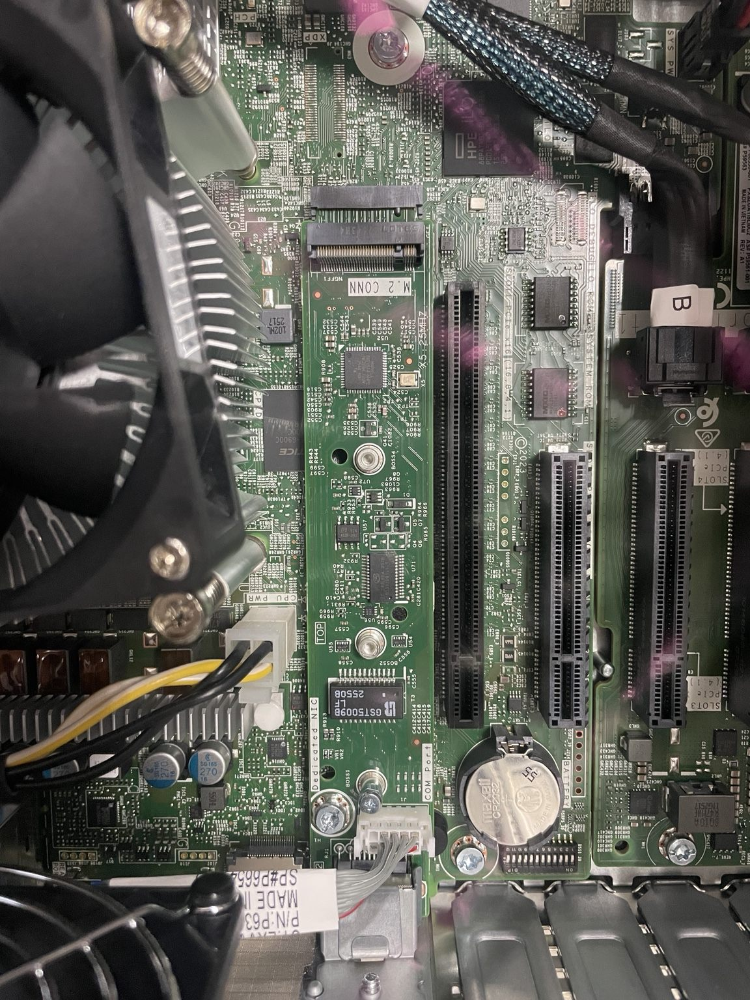
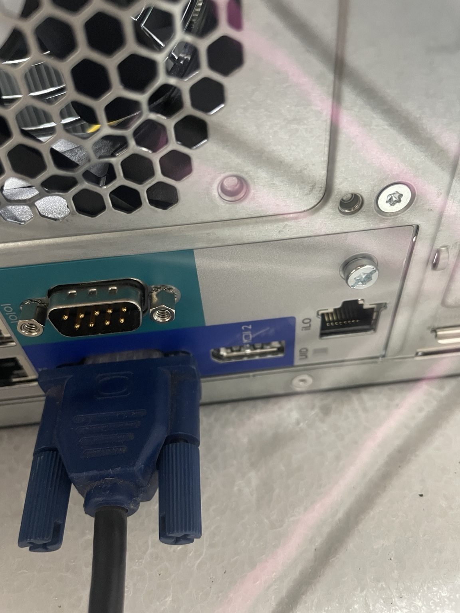
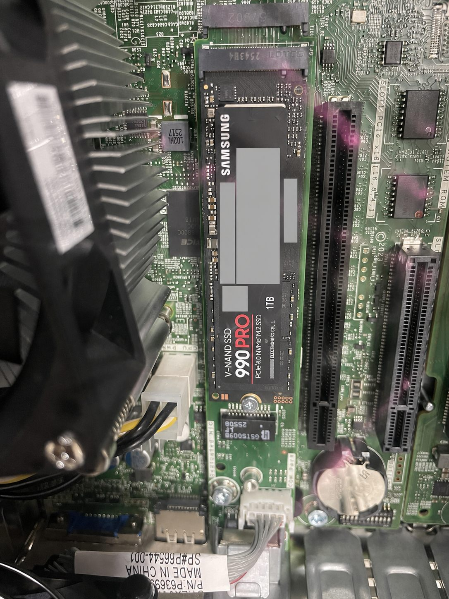
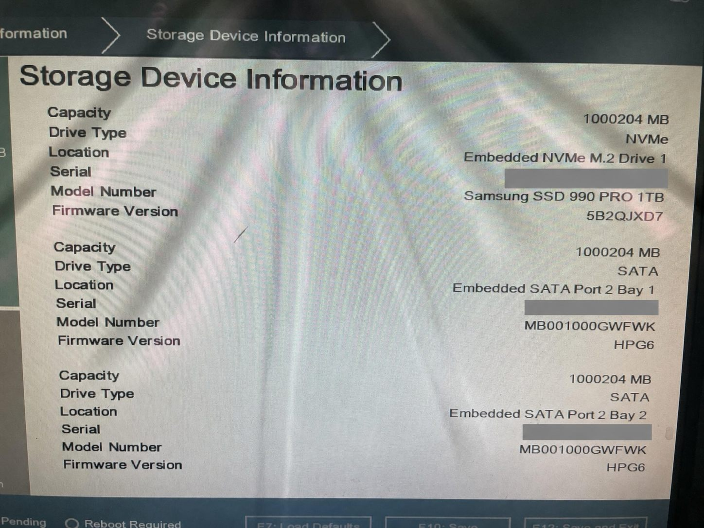
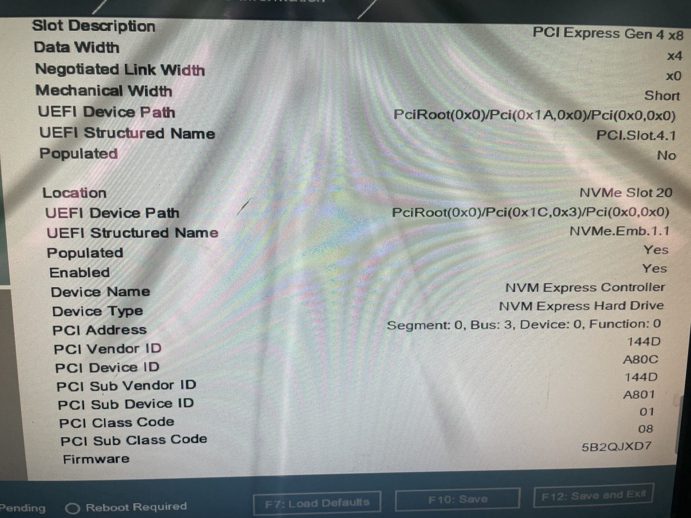
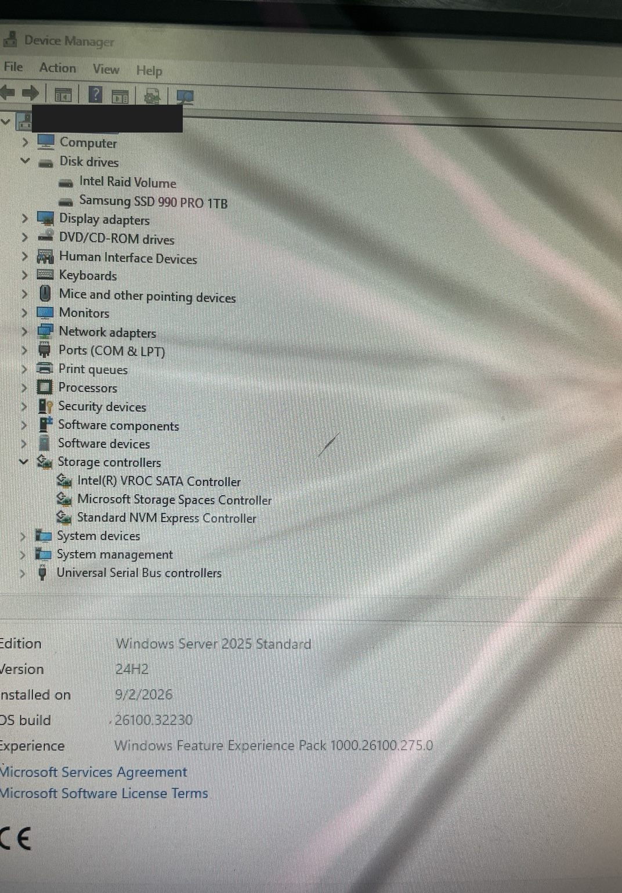

# ML30 Gen11 擴充紀錄：哪些零件裝好了？哪些還要測？

> **一句話**：替一台 HPE ML30 Gen11 伺服器加裝光碟機、管理埠套件和 NVMe SSD，並裝好 Windows Server 2025；這篇記錄每個零件裝了什麼、系統認不認得到，以及還沒驗證的部分。

| 項目 | 內容 |
| --- | --- |
| 適合誰看 | 第一次替伺服器擴充零件的人；要採購同型主機配件的人 |
| 機型 | HPE ProLiant ML30 Gen11 |
| 紀錄日期 | 2026-09-04（Windows 安裝於 2026-09-02；照片中的序號已遮蔽） |
| 結論 | 零件都已安裝並被 UEFI／Windows 辨識；專用 iLO 網路、長時間負載等**仍待驗證** |

> ⚠️ 本篇證明的是**這一台機器**的實際結果，**不等於** HPE 已認證這顆消費型 SSD，也不代表所有同型主機都能不檢查配件就照裝。

## 1. 先認識幾個名詞

| 名詞 | 白話解釋 |
| --- | --- |
| **料號（例如 P65741-B21）** | HPE 每個配件的編號，採購時用它確認買對東西 |
| **iLO** | HPE 伺服器內建的「遠端管理晶片」：就算主機當機，也能遠端開關機、看畫面 |
| **NVMe M.2** | 小型、速度很快的 SSD 規格 |
| **UEFI** | 開機前的韌體設定畫面（新一代的 BIOS） |
| **RAID 1** | 兩顆硬碟存一模一樣的資料（鏡像），壞一顆資料還在 |
| **Intel VROC** | Intel 主機板內建的 RAID 功能，需要對應的驅動程式 |
| **SKU** | 同型號伺服器的不同出廠組態 |

## 2. 最後的配置

| 位置 | 裝置 | 用途與結果 |
| --- | --- | --- |
| P65741-B21 的 M.2 插槽 | Samsung SSD 990 PRO 1TB | 作業系統碟，UEFI／Windows 已辨識 |
| 內建 SATA／Intel VROC | 兩顆 1TB SATA HDD | 組成 RAID 1，當資料碟 |
| 機殼前方 | Slimline 光碟機 | 已安裝，搭配 P65102-B21 套件 |
| 後方擴充介面 | 專用 iLO RJ45、DB9 序列埠 | 已安裝；完整連線與長時間檢查待補 |
| 作業系統 | Windows Server 2025 Standard English | 24H2，build 26100.32230 |

**作業系統放 NVMe、資料放 SATA RAID 1**。RAID 1 只包含兩顆資料碟，NVMe 沒有放進陣列。

## 3. 光碟機：買到光碟機本體，不一定裝得上

本次用 **P65102-B21 Slimline ODD Enablement Kit** 完成安裝。光碟機本體：726536-B21 是 DVD-ROM、726537-B21 是 DVD-RW。除了本體，還要另外核對**套件、線材與機殼槽位（media bay）**。

> 下單前要依實際機型組態核對，不要把「有光碟機料號」當成「所有固定零件都包含」。

## 4. P65741-B21：一次補上三個介面

這個「iLO/NIC/M.2/COM Port Kit」帶來：**專用 iLO 網路埠**、**DB9 序列埠**、**M.2 插槽**。已完成主機板與後方介面的安裝。

- **iLO 原本就有**，可以透過「共用模式」借用 NIC1 網路埠。這個套件是**多一個專用管理埠**，不是裝了才有 iLO。
- 硬體裝上和專用網路驗證是兩件事：專用埠的連線、設定和管理功能**還要另外測**。

## 5. Samsung 990 PRO：認得到，但不代表官方認證

UEFI 顯示：

| 項目 | 讀值 |
| --- | --- |
| 容量 | 1000204 MB |
| 韌體 | 5B2QJXD7 |
| 裝置位置 | Embedded NVMe M.2 Drive 1 |
| 插槽 | Slot 20 |
| Populated／Enabled | Yes／Yes |

這些證據支持「**已安裝且被系統辨識**」；耐久度、故障回報、長時間負載、各種韌體組合**都還沒驗證**。

## 6. SATA RAID 1：先查清楚開機模式與驅動

兩顆 SATA HDD 透過 Intel VROC 組成 RAID 1。規劃時要核對：

| 項目 | 說明 |
| --- | --- |
| 開機與 SATA 模式 | UEFI 開機；BIOS 的 SATA 模式原預設為 AHCI |
| 陣列設定方式 | 本案**不是**透過 Intelligent Provisioning 自動完成 |
| 驅動程式 | 作業系統需要的 VROC 驅動，不能假設 SPP 已包含全部需要的版本 |
| 磁碟相容性 | 磁碟架與尺寸要用確認過的組合，不混用 |

> ⚠️ 變更儲存模式或陣列設定前，先確認硬碟上有沒有資料、有沒有備份。本文是組裝驗證紀錄，**不能**當成「對已有資料的硬碟直接改陣列」的操作指令。

## 7. Windows Server 2025：驗證到哪一層

Windows Server 2025 Standard English 已安裝，裝置管理員認得到儲存裝置與控制器，這支持「**基本安裝與裝置辨識**」。

要交付正式長期運轉，還要補查：AMS（HPE 管理代理程式）、iLO 事件、溫度、驅動與韌體搭配、長時間負載。不能只因桌面正常，就把整台硬體驗收全部勾完。

## 8. 前方風扇／導風罩要不要加？

P65106-B21 Front PCI Fan and Baffle Kit 需不需要，取決於**完整 SKU 與擴充配置**。本案還沒依完整組態核對，所以不能說每台 ML30 Gen11 都必須加裝，也不能說一律不需要。

## 9. 交付前核對表

| 項目 | 狀態 |
| --- | --- |
| 光碟機與線材安裝 | ✅ 已確認 |
| P65741-B21 實體安裝 | ✅ 已確認 |
| 990 PRO 的 UEFI 辨識 | ✅ 已確認 |
| SATA RAID 1 與 Windows 裝置辨識 | ✅ 已確認 |
| Windows Server 2025 安裝 | ✅ 已確認 |
| 專用 iLO 網路完整驗證 | ⏳ 待補 |
| AMS、溫度、事件與長時間負載 | ⏳ 待補 |
| P65106-B21 是否必要 | ⏳ 待完整 SKU 核對 |

## 10. 官方資料來源

- [HPE ProLiant ML30 Gen11 QuickSpecs](https://www.hpe.com/us/en/collaterals/collateral.a50007008enw.html)
- [User Guide：iLO-M.2-serial module option](https://support.hpe.com/hpesc/public/docDisplay?docId=sd00003390en_us&page=GUID-ECB17AD0-D417-4423-8953-388D17BBFB94.html)
- [User Guide：iLO-M.2-serial module components](https://support.hpe.com/hpesc/public/docDisplay?docId=sd00003390en_us&docLocale=en_US&page=GUID-7DED8FBE-383D-4227-B481-30FCE01C26F9.html)
- [User Guide：Installing the iLO-M.2-serial module](https://support.hpe.com/hpesc/public/docDisplay?docId=sd00003390en_us&docLocale=en_US&page=GUID-8BC7ACD9-F979-4D26-BEEE-F709C64C7B95.html)
- [User Guide：Intel VROC support](https://support.hpe.com/hpesc/public/docDisplay?docId=sd00003390en_us&page=GUID-473A3C6B-AA6C-4C0C-89B1-4A3AD962BB15.html)
- [HPE Intel VROC Gen11 OS-specific guides and downloads](https://www.hpe.com/support/VROC-Gen11-UG)

查證日期：2026-09-04（2026-10-30 QuickSpecs 連結改為 HPE 新網址）。HPE 可能更新 QuickSpecs、地區 SKU、支援矩陣與驅動下載位置；採購或部署前請再查最新版本。
